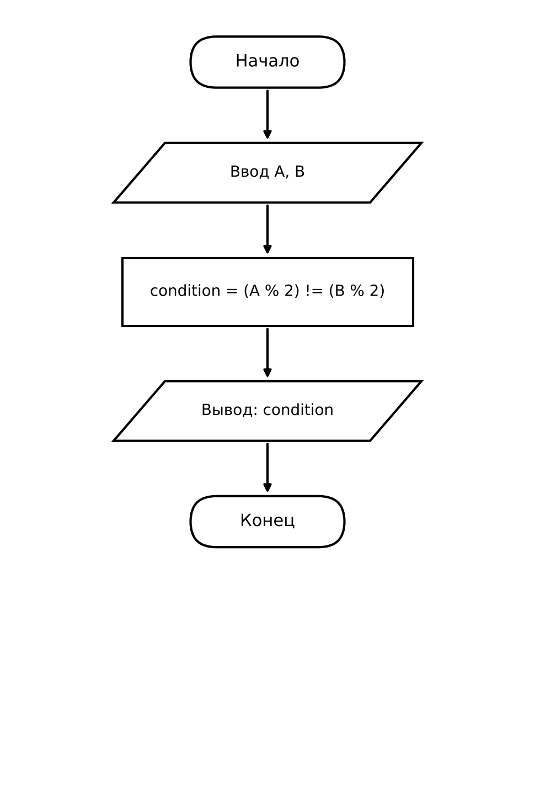

 Домашнее задание к работе 4

## Условие задачи (Вариант 15)

На телевикторине два игрока (A и B) нажали на кнопки. Для победы в раунде нужно, чтобы ровно один из них нажал на кнопку с чётным номером. Запишите условие победы в раунде.

* * *

## 1. Алгоритм и блок-схема

### Алгоритм

1. Запросить у пользователя номера кнопок двух игроков: `A` и `B`.
2. Вычислить логическое условие победы без использования условного оператора `if`:  
   `condition = (A % 2) != (B % 2)`.  
   Остатки от деления на 2 у `A` и `B` различаются только тогда, когда ровно одно из чисел чётное.
3. Вывести результат вычисления логического выражения (1 — победа в раунде; 0 — победы нет).
4. Завершить программу.

### Блок-схема



* * *

## 2. Реализация программы

Исходный код программы: [Source.c](Source.c)

* * *

## 3. Результаты работы программы

Пример работы программы при выполнении условия (ровно один номер чётный):

```
Введите номер кнопки игрока A: 2
Введите номер кнопки игрока B: 3
Победа в раунде (1 - да, 0 - нет): 1
```

Пример работы программы при невыполнении условия (оба номера чётные):

```
Введите номер кнопки игрока A: 2
Введите номер кнопки игрока B: 4
Победа в раунде (1 - да, 0 - нет): 0
```

* * *

## 4. Информация о разработчике

- **ФИО:Гуменников Степан Станиславович**
- **Группа:БОТИ-262** 
